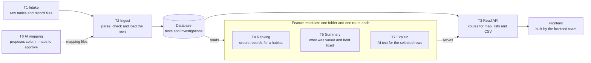

# Backend task division

Last updated: 14 November 2026

The backend splits into nine tasks that connect through data and one shared contract, so two developers can work in parallel. Agree the contract first (T0), then start ingestion (T2) and the read API (T3) at the same time. The two AI tasks are self-contained and can wait for the third developer.

The split follows the team plan and the proposed changes in the Planned document, and it replaces the backend table in section 6 of that plan. Assumed stack: FastAPI, Supabase for the database and file storage, and one model provider (DeepSeek for now). Names, units and folders below are a proposal. The developer on a task decides the details inside their own folder.

## At a glance



Data moves left to right, and each box is one task with its own folder. The three feature modules read the database and are served through the API. T0 (the contract) is the base under every task and is merged before anything else. T8 (deploy) is not drawn.

## Rules of the split

Six rules keep the tasks independent and the merges clean.

1. **Contract first.** T0 is merged to `master` before anyone starts another task.
2. **One task, one folder.** A task edits only its own folder and its own route file.
3. **Shared files change alone.** A change to a contract file goes in its own small pull request, and the others are told.
4. **Tasks meet at data.** Ingest writes the tables and the API reads them. The AI writes mapping files and Ingest reads them. No task imports another task's code.
5. **Stubs before logic.** Every route exists from T0 and returns sample data. The frontend is never blocked, and a task replaces one file.
6. **One branch per task.** Work on `be/<task>` and merge to `master` when the task's check passes, at least every few hours.

## Agree first: the contract

The contract is five things that every task relies on, and T0 writes them down before any other work starts.

| Contract piece | What it fixes | Where it lives |
| --- | --- | --- |
| Test row | One row per test: investigation id, fuel, geometry, oxygen (% by volume), pressure (kPa), flow (cm/s), diluent, outcome, source file and row, and the raw values. An empty field means "not reported", never zero. | `backend/app/schemas.py`, `backend/db/schema.sql` |
| Investigation record | PSI id, acronym, title, summary, hardware, hardware family, safety function, DOI, source link, publications | `data/investigations.json` |
| Habitat | Name, oxygen range, pressure range, gravity, and the NASA source of each number | `data/habitats.json` |
| Mapping file | For one PSI table: which column feeds which field, the unit, the parse rule, and a status (proposed or approved) | `data/mappings/<PSI id>.json` |
| Routes | The list of routes and the shape of each answer, with sample data for each | `backend/app/routers/`, `backend/fixtures/` |

Proposed routes, all under `/api/v1`:

| Task | Route | Answer |
| --- | --- | --- |
| T0 | `GET /health` | Service status |
| T3 | `GET /investigations` | All investigation records, with filters |
| T3 | `GET /investigations/{id}` | One record with its files and publications |
| T3 | `GET /tests` | Test rows for the map, with filters |
| T3 | `GET /tests/{id}` | One test with its source row and raw values |
| T3 | `GET /habitats` | The habitat ranges and their sources |
| T3 | `GET /export/tests.csv` | The merged dataset as a CSV file |
| T4 | `GET /rank?habitat=<id>` | Investigations in order for that habitat, with each part of the score |
| T5 | `GET /investigations/{id}/variables` | Which fields were varied and which were held constant |
| T5 | `POST /compare` | The summaries of several investigations side by side |
| T7 | `POST /explain` | A short explanation of the selected test rows |

## Tasks

Nine tasks cover the backend, and T0 to T4 are needed for the main demo flow. Owners are left open on purpose.

| Task | What it delivers | Needs | Priority | Owner |
| --- | --- | --- | --- | --- |
| T0 Contract and skeleton | An app that starts, settings from the environment, the Supabase connection, the data shapes, the database tables, sample data, a stub for every route, and one small function that calls the model | Nothing | P0, first | |
| T1 Data intake (no coding) | The Experimental Table file from each PSI investigation page, a manifest (PSI id, link, DOI, download date), the investigation list with hardware family and safety function, the habitat ranges with their sources, and a hand-checked sample of rows | The file formats from T0 | P0 for FLEX and BASS-II, P1 for the rest | |
| T2 Ingest | A script that reads a raw table and its approved mapping file, parses the cells, flags doubtful values, loads the rows into the tests table, and writes the merged CSV and a report | T0, two raw tables from T1, and mapping files (written by hand for the first two tables) | P0 | |
| T3 Read API | Routes for the investigation list and detail, the tests for the map with filters, one test with its source row, the habitats, and the CSV download | T0 (runs on sample data until T2 loads real rows) | P0 | |
| T4 Habitat ranking | One function that orders investigations for a chosen habitat, a route that returns the order with each part of the score, and a short note with the formula | T0 | P0 | |
| T5 Test summary and compare | For one investigation, which fields were varied and which were held constant. A compare route puts these summaries side by side, grouped by hardware family. | T0 | P1 | |
| T6 AI mapping assistant | A script that sends a table's header and a few rows to the model and gets back a proposed mapping file, a way for a person to approve or correct it, and an accuracy script that scores proposals against the hand-checked sample | T0, and the hand-checked sample from T1 | P1 | |
| T7 Explain this selection | One route that takes the ids of selected tests, asks the model for a short explanation using only those rows, checks that every cited id was selected, and answers with a plain message when the model fails | T0 | P1 | |
| T8 Deploy and checks | The API running at a shared address, environment variables set, CORS for the frontend, storage for raw tables and the CSV, and a script that calls every route | T0 | P1, earlier if the frontend needs a shared address | |

Each task works in its own place and has one check that says it is done.

| Task | Works in | Done when |
| --- | --- | --- |
| T0 | `backend/app/main.py`, `config.py`, `schemas.py`, `db.py`, `llm.py`, `backend/db/`, `backend/fixtures/` | The app starts, `/health` answers, and every planned route returns sample data |
| T1 | `data/raw/`, `data/manifest.csv`, `data/investigations.json`, `data/habitats.json`, `data/gold/` | The FLEX and BASS-II files and the manifest are in place, then the rest |
| T2 | `backend/ingest/` | FLEX and BASS-II load into an empty database with one command, and the report lists every flagged cell |
| T3 | `backend/app/routers/investigations.py`, `tests.py`, `habitats.py`, `export.py` | Each route returns real rows that match the contract, and the filters work together |
| T4 | `backend/app/ranking/`, `backend/app/routers/rank.py`, `docs/ranking.md` | The same input always gives the same order, and the answer shows each part of the score |
| T5 | `backend/app/summary/`, `backend/app/routers/variables.py`, `compare.py` | For BASS-II, oxygen and the fan setting show as varied, and empty fields show as not reported |
| T6 | `backend/ai/mapping/`, `data/mappings/` | It writes a valid mapping file for a table it has not seen, and the accuracy script prints a score |
| T7 | `backend/ai/explain/`, `backend/app/routers/explain.py` | The answer cites only selected rows, and the route still answers when the model is off |
| T8 | `backend/deploy/`, `backend/scripts/smoke.py` | The smoke script passes against the shared address |

## Proposed layout

```
backend/
  app/
    main.py              T0  registers every route once
    config.py            T0
    schemas.py           T0  the data shapes
    db.py                T0  Supabase connection
    llm.py               T0  one function that calls the model
    routers/
      investigations.py  T3
      tests.py           T3
      habitats.py        T3
      export.py          T3
      rank.py            T4
      variables.py       T5
      compare.py         T5
      explain.py         T7
    ranking/             T4
    summary/             T5
  ingest/                T2
  ai/
    mapping/             T6
    explain/             T7
  db/schema.sql          T0
  fixtures/              T0  sample data for every route
  deploy/                T8
  scripts/smoke.py       T8
data/
  raw/                   T1  Experimental Tables as downloaded from PSI
  manifest.csv           T1
  investigations.json    T1
  habitats.json          T1
  gold/                  T1  hand-checked sample rows
  mappings/              T6 proposes, a person approves, T2 reads
docs/
  ranking.md             T4
```

## Order of work

Two developers start in parallel as soon as T0 is merged. The data intake starts at once, because everything waits on its first two files.

| Step | Developer A | Developer B | Third developer | No coding |
| --- | --- | --- | --- | --- |
| 1. Together | T0 Contract and skeleton | T0 Contract and skeleton | | T1: the FLEX and BASS-II tables, the habitats |
| 2. In parallel | T2 Ingest | T3 Read API | | T1: the other tables, the investigation list |
| 3. In parallel | T4 Habitat ranking | T5 Summary, then T8 Deploy | T6 AI mapping, then T7 Explain | T1: the hand-checked sample, approving mappings |

If the third developer is late, the first free developer takes T6 before T5. One extra waits for spare time: a raw video link per test, with the file names listed in T1 and returned by T3.

## Open questions

Four points need an answer from the team, and none of them blocks T0.

- [ ] Who takes T1, the data intake? It needs no coding, and its first two files are on the critical path.
- [ ] When does the third developer join? Until then T6 and T7 wait, or the first free developer takes T6.
- [ ] Is the hand-in on Sunday evening? The P1 list assumes work continues until then.
- [ ] Do the raw PSI tables go into the repo, or only into Supabase Storage? The tables are small, and the videos never go in.
