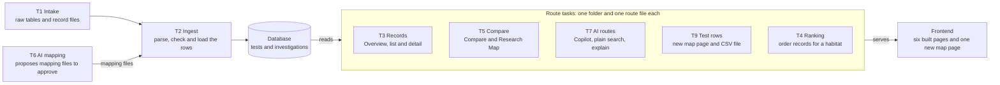

# Backend task division

Last updated: 14 November 2026

The backend splits into ten tasks that connect through data and one shared contract, so two developers can work in parallel. The frontend on `master` is complete on dummy data and already defines the answer shapes for eight routes, so T0 copies those shapes. After T0, ingestion (T2) and the record routes (T3) start at the same time.

The backend does two jobs. It serves the six pages that exist with real PSI records. It also adds the routes for the proposed changes in the Planned document: the merged test dataset, the habitat ranking and a CSV download.

Assumed stack: FastAPI, Supabase for the database and file storage, and one model provider (DeepSeek for now). Names, units and folders below are a proposal. The developer on a task decides the details inside their own folder.

## At a glance



Data moves from the PSI files to the database, and the route tasks serve it to the frontend. Each box is one task with its own folder. T0 (the contract) is the base under every task and is merged before anything else. T8 (deploy) is not drawn.

## Rules of the split

Six rules keep the tasks independent and the merges clean.

1. **Contract first.** T0 is merged to `master` before anyone starts another task.
2. **One task, one folder.** A task edits only its own folder and its own route file.
3. **Shared files change alone.** A change to a contract file goes in its own small pull request, and the others are told.
4. **Tasks meet at data.** Ingest writes the tables and the routes read them. The AI writes mapping files and Ingest reads them. No task imports another task's code.
5. **Stubs before logic.** Every route exists from T0 and returns sample data. The frontend can switch its dummy data off on the first day, and a task replaces one file.
6. **One branch per task.** Work on `be/<task>` and merge to `master` when the task's check passes, at least every few hours.

## Agree first: the contract

The contract is six things that every task relies on, and T0 writes them down before any other work starts.

| Contract piece | What it fixes | Where it lives |
| --- | --- | --- |
| Record shapes | The answers of the eight routes the frontend already calls. They are copied from the frontend, not designed again. | `frontend/ignis-frontend/src/lib/types.ts`, copied into `backend/app/schemas.py` |
| Test row | One row per test: investigation id, fuel, geometry, oxygen (% by volume), pressure (kPa), flow (cm/s), diluent, outcome, source file and row, and the raw values | `backend/app/schemas.py`, `backend/db/schema.sql` |
| Habitat | Name, oxygen range, pressure range, gravity, and the NASA source of each number | `data/habitats.json` |
| Mapping file | For one PSI table: which column feeds which field, the unit, the parse rule, and a status (proposed or approved) | `data/mappings/<PSI id>.json` |
| Sample data | The frontend's 14 dummy records as JSON, so every stub answers with data the pages can show | `frontend/ignis-frontend/src/lib/mock/data.ts`, copied into `backend/fixtures/` |
| Routes | The list below, with a stub for each | `backend/app/routers/` |

Three rules come from the frontend and apply to every answer:

- Field names are snake_case.
- A missing value is `null`, never an empty text or zero.
- A record checked against PSI carries `data_status: "verified"`.

Routes, all under `/api/v1`:

| Task | Route | Used by | Frontend |
| --- | --- | --- | --- |
| T0 | `GET /health` | Checks | Not needed |
| T3 | `GET /dashboard/summary` | Overview, Research Map | Built |
| T3 | `GET /filters` | Explore filters | Built |
| T3 | `GET /investigations` | Explore | Built |
| T3 | `GET /investigations/{id}` | Detail page, Overview | Built |
| T5 | `POST /compare` | Compare | Built |
| T5 | `GET /analytics/coverage` | Research Map | Built |
| T7 | `POST /ai/search` | Explore, "Ask in plain language" | Built |
| T7 | `POST /ai/ask` | Copilot, Compare | Built |
| T9 | `GET /tests` | Map of tests | New page needed |
| T9 | `GET /tests/{id}` | Map of tests | New page needed |
| T9 | `GET /habitats` | Map of tests | New page needed |
| T9 | `GET /export/tests.csv` | CSV download | New link needed |
| T4 | `GET /rank?habitat=<id>` | Habitat ranking | New page needed |
| T5 | `GET /investigations/{id}/variables` | Detail page | New section needed |

"Explain this selection" needs no new route. It is `POST /ai/ask` with the selected `investigation_ids`.

## Tasks

Ten tasks cover the backend. T0 to T3 make the built pages run on real records, and T9 with T4 carry the proposed changes. Owners are left open on purpose.

| Task | What it delivers | Needs | Priority | Owner |
| --- | --- | --- | --- | --- |
| T0 Contract and skeleton | An app that starts, settings from the environment, the Supabase connection, the data shapes copied from the frontend, the database tables, the frontend's sample data as JSON, a stub for every route, and one small function that calls the model | Nothing | P0, first | |
| T1 Data intake (no coding) | The Experimental Table file from each PSI investigation page and a manifest (PSI id, link, DOI, download date). The investigation records with every field the pages show, checked against PSI. The habitat ranges with their sources, and a hand-checked sample of rows. | The file formats from T0 | P0 for FLEX, BASS-II and the record list, P1 for the rest | |
| T2 Ingest | A script that reads a raw table and its approved mapping file, parses the cells, flags doubtful values, and loads the rows into the tests table. It also loads the investigation records, fills each record's conditions from its test rows, and writes the merged CSV and a report. | T0, two raw tables and the record list from T1, and mapping files (written by hand for the first two tables) | P0 | |
| T3 Record routes | The list with search, filters, sorting, pages and match reasons, the detail record, the filter values and the dashboard summary. The search rules are the ones in the frontend's `mockApi.ts`. | T0 (runs on sample data until T2 loads real records) | P0 | |
| T4 Habitat ranking | One function that orders investigations for a chosen habitat, a route that returns the order with each part of the score, and a short note with the formula | T0 | P1 | |
| T5 Compare and coverage | The compare answer for 2 to 4 records, the coverage matrix (topic by fuel class), and for one investigation which fields were varied and which were held constant | T0 | P1 | |
| T6 AI mapping assistant | A script that sends a table's header and a few rows to the model and gets back a proposed mapping file, a way for a person to approve or correct it, and an accuracy script that scores proposals against the hand-checked sample | T0, and the hand-checked sample from T1 | P1 | |
| T7 AI routes | The answer route uses only the records it retrieved or was given, cites only those, lists limitations, and answers with a plain message when the model fails. The search route turns a question into the list's filters, and the backend checks them. | T0 | P1 | |
| T8 Deploy and checks | The API running at a shared address, environment variables set for the backend and the frontend, CORS for the frontend, storage for raw tables and the CSV, and a script that calls every route | T0 | P1, earlier if the frontend needs a shared address | |
| T9 Test rows and export | Routes for the test rows with filters, one test with its source row, the habitats, and the CSV download | T0 (runs on sample data until T2 loads real rows) | P0 | |

Each task works in its own place and has one check that says it is done.

| Task | Works in | Done when |
| --- | --- | --- |
| T0 | `backend/app/main.py`, `config.py`, `schemas.py`, `db.py`, `llm.py`, `backend/db/`, `backend/fixtures/` | The app starts, and with `NEXT_PUBLIC_USE_MOCK=false` every frontend page loads from the stubs |
| T1 | `data/raw/`, `data/manifest.csv`, `data/investigations.json`, `data/habitats.json`, `data/gold/` | The FLEX and BASS-II files, the manifest and the record list are in place, then the rest |
| T2 | `backend/ingest/` | FLEX, BASS-II and the records load into an empty database with one command, and the report lists every flagged cell |
| T3 | `backend/app/search/`, `backend/app/routers/investigations.py`, `filters.py`, `dashboard.py` | Overview, Explore and the detail page show real records, and a search returns the same order as the frontend's dummy backend for the same data |
| T4 | `backend/app/ranking/`, `backend/app/routers/rank.py`, `docs/ranking.md` | The same input always gives the same order, and the answer shows each part of the score |
| T5 | `backend/app/analytics/`, `backend/app/routers/compare.py`, `coverage.py`, `variables.py` | Compare and Research Map show real records, a chart appears when two records share a parameter and unit, and for BASS-II oxygen and the fan setting show as varied |
| T6 | `backend/ai/mapping/`, `data/mappings/` | It writes a valid mapping file for a table it has not seen, and the accuracy script prints a score |
| T7 | `backend/ai/answers/`, `backend/app/routers/ai.py` | Every citation is a record that was retrieved or given, and both routes still answer when the model is off |
| T8 | `backend/deploy/`, `backend/scripts/smoke.py` | The smoke script passes against the shared address, and the frontend runs against it |
| T9 | `backend/app/routers/tests.py`, `habitats.py`, `export.py` | Each route returns real rows that match the contract, the filters work together, and the CSV has one row per test |

## Proposed layout

```
backend/
  app/
    main.py              T0  registers every route once
    config.py            T0
    schemas.py           T0  the data shapes, copied from the frontend's types.ts
    db.py                T0  Supabase connection
    llm.py               T0  one function that calls the model
    routers/
      investigations.py  T3
      filters.py         T3
      dashboard.py       T3
      rank.py            T4
      compare.py         T5
      coverage.py        T5
      variables.py       T5
      ai.py              T7
      tests.py           T9
      habitats.py        T9
      export.py          T9
    search/              T3
    ranking/             T4
    analytics/           T5
  ingest/                T2
  ai/
    mapping/             T6
    answers/             T7
  db/schema.sql          T0
  fixtures/              T0  the frontend's sample data as JSON
  deploy/                T8
  scripts/smoke.py       T8
data/
  raw/                   T1  Experimental Tables as downloaded from PSI
  manifest.csv           T1
  investigations.json    T1
  habitats.json          T1
  gold/                  T1  hand-checked sample rows
  mappings/              T6 proposes, a person approves, T2 reads
docs/
  ranking.md             T4
```

## Order of work

Two developers start in parallel as soon as T0 is merged. The data intake starts at once, because everything waits on its first files.

| Step | Developer A | Developer B | Third developer | No coding |
| --- | --- | --- | --- | --- |
| 1. Together | T0 Contract and skeleton | T0 Contract and skeleton | | T1: the FLEX and BASS-II tables, the record list, the habitats |
| 2. In parallel | T2 Ingest | T3 Record routes | | T1: the other tables |
| 3. In parallel | T9 Test rows and export, then T4 Ranking | T5 Compare and coverage, then T8 Deploy | T6 AI mapping, then T7 AI routes | T1: the hand-checked sample, approving mappings |

If the third developer is late, the first free developer takes T6, and T7 follows. One extra waits for spare time: a raw video link per test, with the file names listed in T1 and returned by T9.

## Open questions

Six points need an answer from the team, and none of them blocks T0.

- [ ] Does the frontend add the new page, the map of tests with the habitat ranking? T9 and T4 serve it.
- [ ] Do the Research Map and Copilot pages stay? If not, the coverage route in T5 and all of T7 can shrink.
- [ ] Who takes T1, the data intake? It needs no coding, and its first files are on the critical path.
- [ ] When does the third developer join? Until then T6 and T7 wait, or the first free developer takes T6.
- [ ] Is the hand-in on Sunday evening? The P1 list assumes work continues until then.
- [ ] Do the raw PSI tables go into the repo, or only into Supabase Storage? The tables are small, and the videos never go in.
